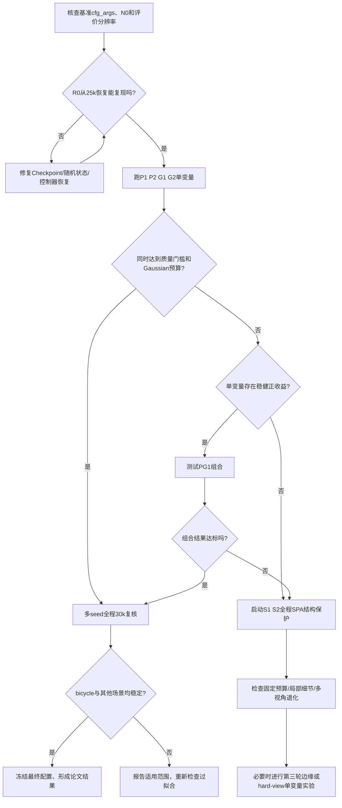

# TAGSs_core 固定高斯预算下的质量提升实验实施方案

> **文档类型**：脚本完善与实验执行规范（可放入 `TAGSs_core/docs/`）  
> **版本**：v1.0 · 2026-10-29  
> **对象**：Mip-NeRF 360 / bicycle；后续可扩展 garden、room  
> **目标**：PSNR ≥ **25.50 dB**、SSIM ≥ **0.785**、LPIPS ≤ **0.175**，同时满足固定 Gaussian 预算与统一分辨率评价  
> **依据**：用户提供的最新 TAGS/3DGS 指标、`THESIS_SYSTEM_DESIGN.md`，以及现有 TAGSs 分阶段架构说明。  
> **状态**：可执行的**实施规范**；文中“建议新增”的配置键和脚本并非已经在当前仓库中验证可用。

---

## 0. 使用前先读：已知事实、未核实项与禁止事项

**已知**：TAGSs 采用 `train_optimized.py`、`experiments/training_engine.py`、`loss_builder.py`、`geo_prior.py`、`sparse_controller.py`、`balanced_late_controller.py`、`evaluator.py` 等模块；已有设计文档给出 30k 的 perceptual-front / geo-late 架构。当前同分辨率 TAGS 的完整指标为 PSNR 25.2944317、SSIM 0.7846885、LPIPS 0.1719476；原始 3DGS 为 25.2328377、0.7661289、0.2086604。

**尚未核实**：实际仓库当前分支、可用的 CLI 参数、当前输出目录、`cfg_args` 中的现行权重、25k Checkpoint 是否含全量状态、当前最终高斯数量 `N0`、完整测试相机的逐张尺寸，以及记录的三个指标是否确实来自相同的样本集合。**使用本文前必须核查这些项**。本文件中的键名如 `late_psnr_multiplier` 都是**建议新增的接口草案**，不是对现有命令行的承诺。

**禁止**：禁止为了提高指标而使用测试视角 GT 参与训练；禁止同一对比中改变正式评价分辨率、数据划分或 `metrics.py` 的实现；禁止把低分辨率 Fast 分数与正式 Full 分数直接混比；禁止隐藏 Gaussian 数量超预算；禁止事后用不同质量的剪枝操作人为“凑数”而不统一复训/评估。

## 1. 实验目标、基准和验收门槛

| 指标 | 当前同分辨率 TAGS | 本轮目标 | 差距 |
|---|---:|---:|---:|
| PSNR（↑） | 25.2944317 dB | ≥25.5000000 dB | **+0.2055683 dB** |
| SSIM（↑） | 0.7846885 | ≥0.7850000 | **+0.0003115** |
| LPIPS（↓） | 0.1719476 | ≤0.1750000 | 最多可回退 **0.0030524** |

**本轮核心问题**：改善 30k 训练末期的像素级拟合，同时尽可能保持 SSIM/LPIPS 的现有收益；不额外增加最终 Gaussian 数量。

### 1.1 Gaussian 预算的两个层次

- **硬上限**：设当前基准最终 Gaussian 数量为 `N0`，任何候选均需 `N_final ≤ N0`；若出于复现误差不能严格达成，必须标记 `budget_fail`，不得称为达标配置。
- **严格匹配组**：为了支持“相同模型规模”的论文论断，优先要求 `abs(N_final-N0)/N0 ≤ 0.005`，**并且**满足上述 `N_final ≤ N0`。两种约束要同时检查。
- 若候选 `N_final` 明显少于 `N0`，它可以成为“更紧凑方案”，但应放在单独的质量—压缩 Pareto 比较中，不应冒充完全等量高斯结果。

### 1.2 同分辨率与同评价集合

- 当前示例图像为 **1237×822**。正式评价应当 **每张 render 与其 GT 的宽高逐一相同**；若场景中不同图像存在不同尺寸，以相机/GT 的真实尺寸为准，而不是盲目统一 resize 到一个固定形状。
- 固定 `--eval --llffhold 8` 所对应的相机划分（该协议来自设计文档），保存测试相机 ID 清单并在不同实验间校验一致。
- 固定相同的曝光/颜色空间处理、背景、遮罩、LPIPS 网络与评测代码版本；相同环境优先。
- 采用**开发验证集**完成参数筛选：只从允许的训练相机中预留少量视角用于开发评估，不把它们同时用于对应候选训练；最终官方测试集只用于确定候选后的验证。若项目目前已经反复在官方测试集上筛参，应如实注明这一限制，并在新增场景和种子上独立复核。

### 1.3 达标不等于已证明泛化

单次候选要同时满足三项质量条件、Gaussian 硬上限、相机/分辨率一致性。论文级的最终接受，还应在预先确定的多个种子上报告均值和标准差，并记录每视角 PSNR 回退情况。

## 2. 项目模块和预计修改点

下面路径来源于 `THESIS_SYSTEM_DESIGN.md`；**实际函数名、参数签名和当前代码分支必须在仓库内核查**。

| 文件（项目根目录相对路径） | 已知职责 | 本轮建议完善事项 |
|---|---|---|
| `train_optimized.py` | 集成训练入口 | 接受/传递新实验配置；记录配置来源与 Resume 来源 |
| `arguments/__init__.py` | CLI 参数定义 | 若当前 argparse 使用这里，新增可选参数并确保默认值不改变基准行为 |
| `experiments/config.py` | `ExperimentConfig` | 增加后期倍数、预算与日志字段；校验非法组合 |
| `experiments/training_engine.py` | 训练循环 | 在正确位置读取调度系数；输出训练指标和 Gaussian 数；保存/恢复状态 |
| `experiments/loss_builder.py` | 复合损失 | 单独输出 `raw_psnr_loss`、`weighted_psnr_loss`、有效权重（不是重复乘权） |
| `experiments/geo_prior.py` | 深度/法线几何损失 | 深度/法线项记录原始值，后期统一缩放，保持现有可信度 Mask |
| `experiments/balanced_late_controller.py` | 晚期动态权重 | 优先把新调度接入这里，避免多处独立修改造成双重缩放 |
| `experiments/sparse_controller.py` | SPA、保护/裁剪 | 新增 Gaussian 目标预算、最终计数核验与候选保护率设置 |
| `experiments/geometry_controller.py` | 其他清理裁剪 | 核查 25k 后是否额外改变 Gaussian 数，尤其对 Resume 公平性的影响 |
| `experiments/evaluator.py` | 指标评价 | 固定相机顺序，输出每视角指标及聚合结果 |
| `render.py`、`metrics.py` | 正式渲染与评价 | 检查图片像素尺寸、视角数和评价实现一致 |
| `scripts/` | 实验运行脚本 | **建议新增** `run_fixed_budget_sweep.sh/.ps1` 或独立驱动脚本，批量运行和收集日志 |

**原则**：先在当前版本 `cfg_args` / 实际源码中确认 PSNR、LPIPS 的最终权重。设计文档记载 LPIPS `init=0.004` 并逐步衰减到 0、PSNR loss `init=0.020 → final=0.010`、SPA `13000–25000`、geo `26000` 启动；如果当前运行分支不同，以当前实际配置为准。**如果 LPIPS 在末期本来就已经为零，不安排“再降低后期 LPIPS”这种无效实验。**

## 3. 完整运行前的基准冻结与复现

### 3.1 保存快照

在 TAGSs_core 根目录执行（Linux / AutoDL 示例，路径按实际修改）：

```bash
pwd
python train_optimized.py --help > output/train_help_snapshot.txt 2>&1
python render.py --help > output/render_help_snapshot.txt 2>&1
python metrics.py --help > output/metrics_help_snapshot.txt 2>&1
git rev-parse HEAD
git status --short
# 查找真实参数定义，而不是直接复制文档中的建议参数名
grep -RInE 'psnr|geo|depth|normal|spa|resume|checkpoint|iteration|protect' \
  arguments experiments train_optimized.py scripts | head -n 180
```

> 先确保 `output/` 存在；上述 `--help` 是否被全部入口支持须以实际运行结果为准。文档中仅把它作为检查动作。Windows PowerShell 可使用 `Select-String` 替代 `grep`。

冻结的证据至少包括：`git_commit.txt`、`git_status.txt`、基准 `cfg_args`、当前 checkpoint 文件清单、训练/测试相机 ID、`metrics.py` 版本、数据集路径和深度先验版本。

### 3.2 确定 `N0`

从当前**30k 正式基准**的 `GaussianModel` 或 PLY 顶点数读取最终 Gaussian 数量并保存为 `N0`。**此处不填猜测值。** 如果 checkpoint 与导出 PLY 的点数不同，应排查导出时额外剪枝/过滤，规定唯一计数时点为“用于正式渲染评价的最终 Gaussian 集合”。

### 3.3 验证 25k Resume

必须先单独执行 **R0（不改变任何超参数）**：

1. 从相同的 25k 完整 checkpoint 恢复到 30k；
2. 检查是否恢复 Gaussian、优化器动量、学习率、SPA/几何控制器、全局 step、随机状态及相机采样状态；
3. 确保 25k–30k 没有重置调度器或再次执行已完成的 SPA 操作；
4. 与原始不中断训练的 30k 结果比较。

**工程预警阈值（不是数学保证）**：如恢复 R0 与原基准差距超过 PSNR 0.02 dB、SSIM 0.001 或 LPIPS 0.002，先定位 Resume 状态差异；若完全可确定性训练，应追求更严格的一致。未通过 R0 复现检查时，不应相信 P1/G1 与原基准的差距。

注意：PLY 往往不含优化器状态，**“从 25k PLY 继续训练”与“从完整 Checkpoint 恢复”是不同实验**。若仓库只有 PLY，请先完善 Checkpoint；否则统一从 0 开始训练候选。

## 4. 第一轮：后期 25k→30k 参数筛选

### 4.1 统一不变量

所有候选使用**相同 25k 完整 Checkpoint**，相同开发验证相机、相同随机种子、相同损失公式、相同已完成的 SPA 状态和相同预算；训练终点都为 30k。该轮仅优化后期动态权重，不改 0–25k 的轨迹。最终 Gaussian 数必须检查。

| ID | 变量 | 25k→30k 改动 | 目的 |
|---|---|---|---|
| `R0` | 不改 | 完整恢复原设置 | Resume 对照 |
| `P1` | PSNR loss | 后期目标权重为现有最终值的 **1.25 倍**（文档示例 0.0125） | 轻度提升像素拟合 |
| `P2` | PSNR loss | 后期目标权重为现有最终值的 **1.50 倍**（文档示例 0.0150） | 较强像素拟合 |
| `G1` | 几何约束 | 深度和法线有效权重均 × **0.75** | 验证是否过约束 |
| `G2` | 几何约束 | 深度和法线有效权重均 × **0.50** | 验证更弱先验 |
| `PG1` | 组合 | 使用 P/G 单变量中有益的组合 | 检查耦合收益/损失 |

`PG1` 只有在前五组至少有一组稳健改进后才运行。25k Checkpoint 公平对照最多为 `6 × 5k=30k` 额外迭代（不含评价与复现成本）。

### 4.2 PSNR 晚期权重：渐变而非骤变

先查清当前 PSNR loss 的数学定义、正负号与归一化，避免把负 PSNR 损失“加大”后产生意外行为。建议只在 loss builder 计算出**原本有效权重**之后乘以一个可记录的倍率，避免两处重复乘法。

候选调度为：

```python
# 伪代码：接口名称为建议新增，不能直接认定仓库已实现

def smooth_ramp(iteration, start=25000, end=27000):
    x = max(0.0, min(1.0, (iteration - start) / (end - start)))
    return x * x * (3.0 - 2.0 * x)

psnr_multiplier = 1.0 + (psnr_final_multiplier - 1.0) * smooth_ramp(iteration)
psnr_weight_effective = psnr_weight_original_schedule * psnr_multiplier
# P1: psnr_final_multiplier=1.25; P2: =1.50
```

如果现有 `BalancedLateController` 已经包含同类调度，应复用它，而不是并列再加一个后期修正器。记录 `original / multiplier / effective` 三列，便于发现实际配置未生效。

### 4.3 几何先验缩放

几何先验原先在 26k 启动、约 28.5k 完成 warmup。保持时序与 Mask 完全不变，只在最终加权处对 depth/normal 两项统一乘以 0.75 或 0.50。**不要同时修改深度置信度阈值、法线类型或 warmup**，否则无法判定因果来源。记录 `depth_raw`、`normal_raw`、`geo_warmup`、`geo_scale`、`depth_weighted`、`normal_weighted`。

### 4.4 对 P/G 的边界检查

- 若 PSNR 上升但 LPIPS >0.175 或 SSIM <0.785，标记为 **质量约束不达标**，可保留作消融，不得作为最终配置。
- 若 G1/G2 的新视角更容易出现 floaters、遮挡错误或几何不连续，不论 PSNR 是否增加，都需在说明中记录该副作用。
- 若权重设置改变后损失出现 NaN/Inf、梯度异常、点数明显超预算，立即停止并登记原因。

## 5. 第二轮：相同 Gaussian 预算下的 SPA 结构保护（需全程 0→30k）

文档记载的现有混合重要性权重为 opacity 20%、贡献 EMA 40%、位置梯度 30%、二维半径 10%，`spa_protect_top_fraction=0.05`，`prune_ratio2=0.04`。本轮只改**保护比例**，其他重要性计算及训练调度暂不动。

| ID | `spa_protect_top_fraction` | 训练起点 | 最终目标 |
|---|---:|---|---|
| `S0` | 0.05 | 0 | `N_final ≤ N0`；严格组匹配 ±0.5% |
| `S1` | 0.08 | 0 | 同上 |
| `S2` | 0.10 | 0 | 同上 |

**核心要求**：保护更多高贡献高斯必须通过“重新选择保留对象”实现，而不是简单减少总裁剪量。可以在同一目标数量下，对保护集合先锁定，再从其他集合裁剪，保持总量一致。

实现建议：

1. `sparse_controller.py` 中新增（建议）`target_gaussians` / `hard_budget` 入口并校验；
2. 输出 `N_before`, `N_protected`, `N_pruned`, `N_after`, `N_final`；
3. 限制任何后续 densification/geometry controller 对最终总数的影响，保证预算不是只在 25k 时满足；
4. 若候选经过不同量的强制末次裁剪，必须记录并考虑重新精修，不能以质量未修复的裁剪结果作为严格公平的组间比较；
5. 对高斯数偏少的候选，单列压缩性能，不伪称 Gaussian 数完全一致。

这一轮**不能从 25k 的旧 Checkpoint 启动**，因为 13k–25k SPA 的中间高斯轨迹已经改变。建议 S1/S2 每组都从相同初始化状态完整训练。

## 6. 预留第三轮：只有前两轮失败时才开展

在第一轮和第二轮均无法达到硬门槛时，再分别考虑：

- Hard-view **损失重加权**最大值：文档现设 1.20，可单变量比较 1.15/1.10；不要切换到文档已报告不稳定的 hard-view **采样**。
- 后期边缘加权 RGB：只使用**训练** GT 生成梯度权重，建议由 27k 后线性或 smoothstep 渐入；单独消融，不与 hard-view 参数同时改变。
- 几何 Mask/置信度调整：需要额外几何一致性对照；不能仅因 PSNR 好就证明几何先验更准确。

## 7. Debug / Fast / Full 三级验证

| 级别 | 环境 | 运行内容 | 能得出的结论 |
|---|---|---|---|
| **Debug** | Windows + RTX 3060/4060 | 低分辨率、短迭代、极少相机；测试 Resume、权重倍率、预算断言、日志输出 | 只能说明实现正确性，不能得出论文质量结论 |
| **Fast** | 本地足够显存则 25k→30k；否则云端短段恢复 | 用固定开发验证相机筛 R0/P1/P2/G1/G2；同一阶段/图像尺度比较 | 参数趋势和回归定位，不替代 Full |
| **Full** | 云端 | 完整 bicycle、30k、原 GT 分辨率、固定 `N0`、多随机种子；多场景复验 | 论文正式定量结果 |

如本地无法装入 25k 的完整场景模型，不要勉强使用 CUDA OOM 风险更高的局部裁剪版 Checkpoint 作为同等质量候选；将本地用于单元/短程 Debug，云端执行候选 5k 后期训练。

## 8. 实验日志、目录与可追溯性

推荐目录（**建议新增**，并非现有仓库自带）：

```text
TAGSs_core/
├── docs/
│   └── TAGS_FIXED_BUDGET_EXPERIMENT_PLAN.md
├── scripts/
│   └── run_fixed_budget_sweep.sh        # 待新增；Windows 可建 .ps1
└── output/
    └── tags_budget_sweep/
        ├── baseline_R0/
        ├── psnr_P1/
        ├── psnr_P2/
        ├── geo_G1/
        ├── geo_G2/
        ├── combined_PG1/
        ├── sparse_S1/
        ├── sparse_S2/
        └── reports/
            ├── experiment_registry.csv
            ├── training_curves.csv
            ├── per_view_metrics.csv
            └── final_comparison.csv
```

**每个 run 的不可缺少元数据**：唯一 run ID、代码 commit、完整命令、`cfg_args`、seed、数据集 hash 或版本、camera IDs、train/eval 分辨率、checkpoint 路径+hash、CUDA/PyTorch 版本、GPU、实际训练时间、峰值显存、`N0`、`N_final`、所有有效损失权重与计数轨迹。

### 8.1 `experiment_registry.csv`

建议列：`run_id,seed,stage,start_iter,end_iter,checkpoint_source,git_commit,eval_protocol,train_scale_schedule,eval_resolution,psnr_final_multiplier,geo_scale,spa_protect_fraction,N0,N_final,budget_delta_pct,psnr,ssim,lpips,train_seconds,peak_vram_mb,official_test_used,quality_pass,budget_pass,matched_budget_pass,notes`。

填写原则：**一行一个 run × seed**，不覆盖历史结果；缺失值为空且标记原因。`quality_pass` 必须用未截断数值判定。

### 8.2 `training_curves.csv`

建议列：`run_id,seed,iteration,stage,loss_total,loss_rgb,loss_ssim,loss_psnr_raw,loss_psnr_weighted,loss_lpips_raw,loss_lpips_weighted,loss_depth_raw,loss_depth_weighted,loss_normal_raw,loss_normal_weighted,psnr_multiplier,geo_scale,spa_penalty,gaussians,dev_psnr,dev_ssim,dev_lpips,elapsed_seconds`。

训练步频可以每 500 步记一次；开发视角评价每 1000 步一次即可，避免频繁评测吞噬训练时间。**重点检查 25k、26k、28.5k、30k 时刻的有效权重和高斯数**。

### 8.3 `per_view_metrics.csv`

建议列：`run_id,seed,split,view_id,width,height,psnr,ssim,lpips,delta_psnr_vs_R0,delta_ssim_vs_R0,delta_lpips_vs_R0`。

以**完全相同的视角 ID**为主键配对 R0 与候选，附带同分辨率断言；统计每视角 PSNR 低于 R0 **0.2 dB 以上**的比例，建议将该比例 >20% 设为工程预警，不应把它描述成学术通用阈值。可输出平均值、中位数、P10/P90 和劣化视角数，避免只选最好的一帧展示。

### 8.4 `final_comparison.csv`

建议列：`run_group,seed_count,psnr_mean,psnr_std,ssim_mean,ssim_std,lpips_mean,lpips_std,gaussians_mean,gaussians_std,train_minutes_mean,render_fps_mean,quality_pass,model_budget_pass,notes`。

最终 3 seed（推荐 0/1/2，需与既有历史一致时统一使用同一列表）报告均值±标准差，并同时提供逐视角结果。实验中途不要为某一候选额外挑选有利 seed。

本文件随附 `templates/` 目录含以上四种 CSV **空表头模板**，便于复制到 `output/tags_budget_sweep/reports/`。

## 9. 实验门槛及候选选择

严格质量门槛：

```python
# 此处为评估逻辑示例，不要求直接塞入训练循环
quality_pass = (psnr >= 25.50 and ssim >= 0.785 and lpips <= 0.175)
budget_pass = (N_final <= N0)
matched_budget_pass = budget_pass and abs(N_final - N0) / N0 <= 0.005
success = quality_pass and matched_budget_pass
```

还应设置 `same_views_and_resolution` 和 `valid_resume` 检查，最终成功必须两者为真。**严禁把 `25.4996` 四舍五入为 `25.50` 来标记通过。**

选择次序：

1. 删除任何违反数据/指标公平性、Gaussian 硬上限或质量门槛的候选；
2. 优先选择严格匹配 Gaussian 数且开发集稳定、逐视角明显退化较少的候选；
3. 通过门槛的候选优先比较 PSNR，再比较 LPIPS、SSIM 与训练/渲染开销；
4. 固定候选后使用正式测试集一次性确认，并在多个 seed、多场景检验稳定性；
5. 对没有完全达标但形成更好的质量—效率 Pareto 点的实验，诚实报告，不强行宣称“全部指标达标”。

## 10. 建议新增的配置接口（非现有 CLI 命令）

尽量沿用当前 `ExperimentConfig` 和参数传递体系；下列是统一命名的**设计草案**，要先在 `arguments/__init__.py` 与 `experiments/config.py` 中明确映射关系。

```yaml
# DESIGN ONLY：不能未经实现就将本文件当成程序支持的 YAML
experiment_id: P1
seed: 0
iteration_limit: 30000
resume_iteration: 25000
resume_checkpoint: "<25k完整checkpoint实际路径>"
quality_targets:
  psnr_min: 25.50
  ssim_min: 0.785
  lpips_max: 0.175
late_schedule:
  psnr_final_multiplier: 1.25       # R0=1.0, P2=1.50
  psnr_ramp_start: 25000
  psnr_ramp_end: 27000
  geo_scale: 1.00                   # G1=0.75, G2=0.50
  geo_start_iter: 26000            # 原时间表不改
sparse_budget:
  final_target_gaussians: "<N0>"   # 用实际整数替换
  hard_max_gaussians: "<N0>"
  matched_tolerance_ratio: 0.005
  spa_protect_fraction: 0.05       # S1=0.08, S2=0.10
validation:
  protocol: "llffhold_8"
  full_resolution: true
  per_camera_exact_size: true
```

**实现策略**：在现有 `config` 增加候选开关时，默认全部设置为“乘数 1 / 预算检查关闭”，确保原有 TAGS 基准无行为变化；先写单元级断言验证不同迭代倍率正确，再用于真实 GPU 训练。不要在 `loss_builder.py` 与 `balanced_late_controller.py` 各自乘一次倍率。

## 11. 运行命令的核查与模板

**文档已给出的现有命令（以你的实际仓库为准）**：

```powershell
# Windows PowerShell，在实际仓库目录执行
cd D:\TAGSs\TAGSs_core
.\scripts\run_bicycle_v4_restore.ps1

# 如果对应目录可被现有 render.py / metrics.py 识别
python render.py -m output/bicycle_integrated_perceptual_front_geo_late
python metrics.py -m output/bicycle_integrated_perceptual_front_geo_late
```

**尚不能直接运行的候选实验命令示意**：

```bash
# TODO: 完成项目实际 CLI 绑定后，把以下标签映射到 train_optimized.py 可识别的真实选项
# run_case R0 --checkpoint "$CKPT25" --psnr-mul 1.00 --geo-scale 1.00
# run_case P1 --checkpoint "$CKPT25" --psnr-mul 1.25 --geo-scale 1.00
# run_case P2 --checkpoint "$CKPT25" --psnr-mul 1.50 --geo-scale 1.00
# run_case G1 --checkpoint "$CKPT25" --psnr-mul 1.00 --geo-scale 0.75
# run_case G2 --checkpoint "$CKPT25" --psnr-mul 1.00 --geo-scale 0.50
# 注意：上面的 run_case/--psnr-mul 等仅是待实现驱动器示意，不是现存可执行命令。
```

在 AutoDL 中，先 `cd` 到实际项目根目录（可能是 `/root/autodl-tmp/TAGS/TAGSs_core` 或历史版本目录），通过 `pwd` 与 `ls train_optimized.py` 验证，不要直接覆盖旧的 `TAGSs_bicycle_v14` 结果。

## 12. 实验结果决策树



## 13. 逐项验收清单（可在仓库中勾选）

### 环境和基准

- [ ] 确认 `TAGSs_core` 路径与当前 Git commit，保存 `git status`。
- [ ] 确认当前 PSNR/LPIPS/Geo 实际有效权重，避免依据旧文档误改。
- [ ] 保存当前 TAGS `cfg_args` 和未截断完整指标。
- [ ] 确定 `N0` 与计数时点，确保导出模型和评价使用同一高斯集合。
- [ ] 保存训练/开发/测试相机 ID 列表，逐视角尺寸一致。
- [ ] 验证 25k 完整 Checkpoint 能正确 Resume 并复现 R0。

### 代码修改

- [ ] 在统一参数配置中引入 `psnr_final_multiplier`、`geo_scale`，原默认行为不变。
- [ ] 只在一处施加倍率，记录 raw/effective losses 与实际权重。
- [ ] 为 Gaussian 总数加入硬上限与末期核验，未达标自动标记失败。
- [ ] 确保各实验有唯一输出目录、不会覆盖历史 checkpoint。
- [ ] 输出 `experiment_registry.csv`、`training_curves.csv`、`per_view_metrics.csv`。

### 执行和交付

- [ ] 先跑 R0，再跑 P1/P2/G1/G2；通过后才跑 PG1。
- [ ] 如需改 SPA，S1/S2 由初始状态完整训练，不复用旧 25k SPA 轨迹。
- [ ] Fast 使用开发验证视角；Full 统一全分辨率与官方协议。
- [ ] 报告每视角退化率、最终 Gaussian 数、训练时间、峰值显存。
- [ ] 对候选做至少 3 seed 正式复核，冻结配置后扩展其他场景。
- [ ] 在论文中将“目标、观察结果、已验证的解释”明确区分。

---

## 14. 推荐执行顺序（最精简版本）

**Day/Phase A：先排查而非盲训。** 读取真实 `cfg_args` → 记录 `N0` → 检查 eval 协议 → 检查 25k 完整 Checkpoint → R0 复现。

**Phase B：只改后期权重。** P1、P2、G1、G2 → 比较开发集及逐视角回退 → 有效时再跑 PG1。

**Phase C：再改高斯保留。** 若质量门槛仍未满足或高频细节不足，从 0 开始跑 S1/S2，确保与 S0 在固定高斯预算下可比。

**Phase D：冻结和正式验证。** 同一正式测试协议、3 seeds、完整分辨率、Gaussian 预算，补充模型大小/渲染 FPS 和跨场景结果。

**首要行动**：先确认当前 `cfg_args`、25k Checkpoint 类型、`N0`。如果这三项没有确定，先不批量执行 P/G/S 参数扫描。

---

### 参考材料

1. 用户上传：`THESIS_SYSTEM_DESIGN.md`（TAGSs 模块、训练阶段、历史实验、评价与脚本路径）。
2. 用户在当前对话提供的同分辨率 TAGS / 原始 3DGS 指标与 bicycle GT 图。
3. Lee, Hong, Suh (2025), *Prior-Driven Enhancements in 3D Gaussian Splatting: Normals and Depths Regularization*（作为几何先验风险与相关工作的参考，不意味着其中参数可直接移植到 TAGSs）。

**注意**：本文是工程操作指南而非自动修改仓库的脚本；在接入当前分支之前，所有标注“建议新增/伪代码/TODO”的配置项均不可直接运行。


## 2026-10-29 工程接入更新

已接入后期倍率、固定SPA目标、完整状态checkpoint与前台实验驱动。实际命令、支持范围及未验证项见 [TAGS_FIXED_BUDGET_RUNBOOK.md](TAGS_FIXED_BUDGET_RUNBOOK.md)。原文目标和验收条件保持为待实验验证，不能视为本次已达到。
