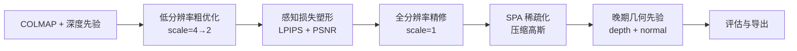

# TAGSs 毕业设计综合文档

> **文档用途**：整合论文题目、系统名称、系统设计思路、实验内容与代码映射，供开题报告、论文撰写与答辩准备使用。  
> **生成日期**：2026-08-25  
> **代码仓库**：`TAGSs_core`

---

## 一、论文与系统命名

### 1.1 论文题目（推荐定稿）

> **基于 3D Gaussian Splatting 的分阶段几何-感知协同场景重建研究与应用**

| 模板位置 | 对应内容 |
|----------|----------|
| **基于** | 3D Gaussian Splatting（Kerbl et al., SIGGRAPH 2023） |
| **本文方法** | 分阶段几何-感知协同优化（perceptual-front / geo-late） |
| **研究与应用** | 方法研究 + TAGSs 三维场景重建系统实现与演示 |

**备选 shorter 标题：**

- 基于 3DGS 的分阶段几何-感知协同优化三维重建研究与应用
- 基于 3DGS 的分阶段几何-感知三维重建研究与应用

### 1.2 系统名称

> **TAGSs：基于分阶段几何-感知协同优化的高质量 3D Gaussian 场景重建与浏览系统**

- **TAGSs** = **T**raining framework for **A**daptive **G**aussian **S**platting **S**ystem（项目内部命名，可在论文中解释为集成优化训练框架）
- 英文副标题（可选）：*TAGSs: A Staged Geometry-Perception Co-Optimization Framework for High-Quality 3D Gaussian Scene Reconstruction*

### 1.3 一句话定位

用户上传多视角图像（或视频抽帧）→ 系统自动完成位姿估计、深度先验生成、分阶段 3DGS 优化与稀疏压缩 → 输出紧凑 3D Gaussian 模型 → 支持自由视角实时浏览。

### 1.4 摘要示例

> 本文基于 3D Gaussian Splatting，针对复杂场景重建中几何不稳定、模型冗余、单目深度噪声干扰结构建立等问题，设计并实现 TAGSs 三维场景重建系统。系统采用本文提出的 **perceptual-front / geo-late 分阶段协同优化策略**：训练前期以 LPIPS 与 PSNR 感知损失塑造外观，中期通过困难视角损失重加权与 GaussianSpa 自适应稀疏化压缩模型，晚期在 SPA 结束后引入边缘可靠的单目深度/法线几何先验 refine 结构。实验在 Mip-NeRF 360 数据集及多场景对比中验证了方法在 PSNR、SSIM、LPIPS 指标与模型紧凑性方面的有效性，并完成从图像输入到自由视角浏览的端到端演示。

---

## 二、应用场景与系统目标

### 2.1 应用场景

**复杂室内外场景三维重建**：用户通过多视角图像或视频输入，对室内外环境进行三维重建，自动生成高质量、紧凑的 3D Gaussian Scene，并支持自由视角实时浏览。

### 2.2 系统目标

| 目标 | 说明 | 当前实现状态 |
|------|------|--------------|
| **高质量重建** | 提升 PSNR / SSIM / LPIPS，减少 floaters 与几何伪影 | ✅ 核心算法已实现，bicycle 场景有量化结果 |
| **紧凑模型** | 通过稀疏优化减少高斯数量，降低存储与渲染开销 | ✅ GaussianSpa SPA 模块已实现 |
| **稳定训练** | 分阶段策略避免早期深度噪声破坏结构 | ✅ perceptual-front / geo-late 已落地 |
| **端到端流程** | 图像/视频 → 重建 → 浏览 | ⚠️ 需封装统一 Pipeline 与 Viewer 演示 |
| **多场景泛化** | 室内外多场景验证 | ⚠️ 当前主要在 bicycle 单场景深度调参，需扩展 |

### 2.3 项目本质定位

TAGSs 不是在 SLAM 意义上从零构建重建管线，而是在 **Inria 官方 3DGS** 基础上扩展的 **集成优化训练框架**：

- 新增 `train_optimized.py` 与 `experiments/` 模块
- 将 DN-Splatter 风格几何先验、GaussianSpa 稀疏优化、多分辨率调度、感知损失等统一纳入 `TrainingEngine`
- 通过系统化消融实验（v2 → v15）迭代最优配置

**论文叙事建议**：以「系统 + 方法」双线展开——系统负责端到端流程与演示，方法负责分阶段协同优化策略与模块集成。

---

## 三、系统总体设计

### 3.1 四层系统架构

```
┌─────────────────────────────────────────────────────────────────┐
│  1. 数据接入层                                                    │
│     多视角图像文件夹 / 视频抽帧（ffmpeg）                          │
└────────────────────────────┬────────────────────────────────────┘
                             ▼
┌─────────────────────────────────────────────────────────────────┐
│  2. 预处理层                                                      │
│     COLMAP SfM（相机位姿）→ Depth Anything V2/V3（单目深度）       │
│     → 深度尺度标定（depth_params.json）                           │
└────────────────────────────┬────────────────────────────────────┘
                             ▼
┌─────────────────────────────────────────────────────────────────┐
│  3. 重建优化层（核心贡献）                                         │
│     TrainingEngine 统一调度                                       │
│     ├─ 感知前期：LPIPS + PSNR                                    │
│     ├─ 中期：困难视角重加权 + SPA 稀疏化                          │
│     ├─ 晚期：depth + normal 几何先验                              │
│     └─ 模型导出：compact 3DGS .ply                                │
└────────────────────────────┬────────────────────────────────────┘
                             ▼
┌─────────────────────────────────────────────────────────────────┐
│  4. 展示层                                                        │
│     定量评估：render.py + metrics.py（PSNR/SSIM/LPIPS）           │
│     定性演示：SIBR Viewer / gsplat Web Viewer / 录屏漫游           │
└─────────────────────────────────────────────────────────────────┘
```

### 3.2 标准数据目录结构

```
data/<scene_name>/
  images/                  # 输入多视角图像
  sparse/0/                # COLMAP 输出（cameras, images, points3D）
  depth_any_out/           # Depth Anything 生成的单目深度图
  depth_params.json        # 深度尺度标定参数
```

### 3.3 各层职责与实现来源

#### 层 1：数据接入层

| 功能 | 实现建议 | 状态 |
|------|----------|------|
| 图像文件夹输入 | 直接放入 `data/<scene>/images/` | 已有 |
| 视频抽帧 | `ffmpeg -i video.mp4 -qscale:v 2 -r 2 frames/%05d.jpg` | 待封装 |
| 统一入口 | `scripts/pipeline_prepare.py`（建议新增） | 待开发 |

#### 层 2：预处理层

| 功能 | 工具/模块 | 路径 |
|------|-----------|------|
| 相机位姿估计 | COLMAP | 外部工具，结果由 `scene/` 读取 |
| 单目深度生成 | Depth Anything V2/V3 | `Depth-Anything-V2/`, `Depth-Anything-3/` |
| 深度尺度标定 | depth_params.json | `data/bicycle/sparse/0/depth_params.json` |
| 深度导出脚本 | export_depths_for_tags.py | `Depth-Anything-3/export_depths_for_tags.py` |

#### 层 3：重建优化层（核心）

| 功能 | 代码模块 | 路径 |
|------|----------|------|
| 训练入口 | train_optimized.py | 项目根目录 |
| 统一调度引擎 | TrainingEngine | `experiments/training_engine.py` |
| 复合损失 | LossBuilder | `experiments/loss_builder.py` |
| 几何先验 | GeometricPriorLoss | `experiments/geo_prior.py` |
| 稀疏优化 | SparseController | `experiments/sparse_controller.py` |
| 多分辨率调度 | ResolutionSchedule | `experiments/resolution_schedule.py` |
| 分组学习率 | GroupLRScheduler | `experiments/group_lr_scheduler.py` |
| 几何控制器 | GeometryController | `experiments/geometry_controller.py` |
| 晚期协调 | BalancedLateController | `experiments/balanced_late_controller.py` |
| 评估 | Evaluator | `experiments/evaluator.py` |

**一键训练命令：**

```powershell
cd D:\TAGSs\TAGSs_core
.\scripts\run_bicycle_v4_restore.ps1
```

默认输出目录：`output/bicycle_integrated_perceptual_front_geo_late`

#### 层 4：展示层

| 功能 | 工具 | 路径 |
|------|------|------|
| 测试集渲染 | render.py | 项目根目录 |
| 指标计算 | metrics.py | 项目根目录 |
| 实时浏览 | SIBR Viewer（3DGS 官方）或 gsplat Web | 外部集成 |
| 实验分析 | 各类 summarize 脚本 | `scripts/` |

---

## 四、核心方法设计

### 4.1 总体思路：分阶段、多约束、晚精修

传统集成方案（geo-early）在训练早期即引入单目深度先验，易被 Depth Anything 在边缘、高频纹理处的噪声带偏，导致 floaters 或细节损失。本文提出 **perceptual-front / geo-late** 策略，将几何先验推迟至 SPA 稀疏化完成之后。



### 4.2 分阶段训练时间表（perceptual-front / geo-late，30k 迭代）

| 阶段 | 迭代区间 | 内容 | 设计意图 |
|------|----------|------|----------|
| **早期感知** | 1 → ~8000 | LPIPS + PSNR 监督，几何先验关闭 | 先建立稳定外观与高频细节 |
| **中期困难视角** | 8000 → 25000 | 困难视角损失重加权（不改采样），LPIPS 逐步衰减 | 重点优化高误差视角，避免采样扰动 |
| **SPA 稀疏化** | 13000 → 25000 | GaussianSpa（全分辨率 + 3k delay 后启动） | 在全分辨率稳定后压缩模型 |
| **晚期几何** | 26000 → 30000 | depth + normal 先验 warmup（法线仅 cosine，无 TV） | SPA 结束后 refine 结构，避免与稀疏化冲突 |

### 4.3 关键超参数摘要

| 模块 | 关键参数 |
|------|----------|
| LPIPS | init=0.004, start iter=1, interval=8, 逐步衰减至 0 |
| PSNR loss | init=0.020, final=0.010, start iter=1 |
| Hard-view | `--enable_hard_view_loss_reweight`, start=8000, max=1.20 |
| 分辨率调度 | `"1200:4,4000:2,30000:1"` |
| SPA | start=13000, end=25000, prune_ratio2=0.04, hybrid metric |
| Geo prior | start=26000, warmup_until=28500 |
| Normal | cosine only, `normal_prior_tv_weight=0.0` |

### 4.4 三大技术模块

#### 模块 A：几何先验（GeometricPriorLoss）

借鉴 DN-Splatter 的深度/法线监督思想，适配 Inria 3DGS 渲染管线。

| 组件 | 算法要点 |
|------|----------|
| **深度损失** | 默认 edge-aware log-L1：在 RGB 边缘处降低深度惩罚权重 |
| **局部 Pearson** | 128×128 patch 采样，缓解单目深度尺度漂移 |
| **法线损失** | 由深度图估计法线，cosine 距离 |
| **可靠性掩码** | 综合 depth edge、RGB edge、局部方差，保证最少 20% 像素参与 |
| **权重调度** | warmup → peak → decay；低纹理区域 relax |

代码：`experiments/geo_prior.py`  
参考：`third_party/dn-splatter/`

#### 模块 B：自适应稀疏优化（SparseController）

借鉴 GaussianSpa (CVPR 2025) 的 optimizing-sparsifying 框架。

| 步骤 | 说明 |
|------|------|
| **ADMM 惩罚** | 对 opacity 引入辅助变量 z 与拉格朗日乘子 u |
| **Sparsifying** | 每 spa_interval 步更新 z，将低重要性 opacity 置零 |
| **Final prune** | spa_end_iter 时按 prune_ratio2 一次性剪枝 |
| **Hybrid 重要性** | opacity (20%) + 渲染贡献 EMA (40%) + 位置梯度 (30%) + 2D 半径 (10%) |
| **结构保护** | spa_protect_top_fraction=0.05 保护高贡献高斯 |

代码：`experiments/sparse_controller.py`  
参考：`third_party/GaussianSpa/`

#### 模块 C：多尺度自适应训练

| 机制 | 说明 |
|------|------|
| **分辨率调度** | 1/4 res → 1/2 res → full res，降低早期显存与时间开销 |
| **联动 densify** | densification 截止时间延长至全分辨率就绪 |
| **SPA 延迟启动** | 全分辨率稳定 3k iter 后再启动稀疏化 |
| **分组学习率** | 三阶段分别调节 geometry 与 color 参数学习率 |
| **几何控制器** | 周期性 prune oversized + 低 opacity 高斯 |

代码：`experiments/resolution_schedule.py`, `group_lr_scheduler.py`, `geometry_controller.py`

### 4.5 基础 photometric 损失

\[
\mathcal{L}_{photo} = (1-\lambda_{dssim})\|I - \hat I\|_1 + \lambda_{dssim}(1 - SSIM(I, \hat I))
\]

默认 `lambda_dssim=0.2`；可选 per-view 曝光补偿（Hierarchical 3DGS 思路）。

---

## 五、实验设计与演进

### 5.1 实验基准

| 项目 | 说明 |
|------|------|
| 主 benchmark | Mip-NeRF 360 `bicycle` 场景 |
| 评估协议 | `--eval --llffhold 8`，30k 迭代 |
| 指标 | PSNR ↑ / SSIM ↑ / LPIPS ↓ |
| 工具 | `render.py` + `metrics.py` |

### 5.2 要解决的问题

**几何与外观质量：**

- 浮点伪影（floaters）与几何不稳定
- 单目深度噪声（边缘、高频纹理处不可靠）
- 感知质量不足（纯 L1 + SSIM 对高频细节不敏感）
- 跨视角颜色/曝光不一致

**训练效率与模型规模：**

- 高分辨率训练显存与时间开销大
- 高斯数量膨胀（densification 后点数过多）
- 困难视角欠拟合（均匀随机采样无法重点优化高误差视角）

### 5.3 版本演进时间线

| 版本 | 代表脚本 | 主要变化 | 最佳 PSNR | 结论 |
|------|----------|----------|-----------|------|
| origin | train.py | 原始 3DGS 基线 | 25.151 | 对比起点 |
| v2 | v2_ablation | geo / resolution / spa / integrated 四组消融 | — | 集成显著优于单模块 |
| v3 | integrated_v3 | masked depth prior、保守 SPA | — | 为 v4 奠定基础 |
| v4_restore | run_bicycle_v4_restore | A100 全分辨率生产基线 | **25.495** | 稳定结构骨架 |
| v8 | run_bicycle_v8_v4restore_refine | color + geo 轻度延长 | **25.513** | A100 全分辨率历史最优 |
| v14 | run_bicycle_v14_polish_checkpoint | 28500 checkpoint select | **25.518** | 唯一通过 v8 gate 的 A100 候选 |
| v15 E1b | run_bicycle_v15_30k_densify_fix | densify_until=7200 + late_stabilize | **26.69** | 3080 `images_4` 主配方 |
| v16 | run_bicycle_v16_resolution_aware | resolution-aware 调度 | **26.91** | 当前本地最优 |

### 5.4 关键实验结论

**已验证有效的方向：**

1. **三模块集成**（geo + resolution + SPA）相对 origin 提升 +0.344 dB PSNR
2. **hard-view 损失重加权**（非采样）稳定有效
3. **color align 晚期精修**与 **geo decay 延长** 有微弱正向收益
4. **perceptual-front / geo-late** 解决早期深度噪声与结构建立的冲突

**已证伪或收益递减的方向：**

1. hard-view **采样**（v5）—— 扰动过大，不稳定
2. 强 LPIPS / detail micro loss（v7）—— LPIPS 训练视角回退
3. v8–v11 晚期微调 —— 全局 +0.02 dB 但 40% 视角 PSNR 回退
4. 纯 late-stage 调参 —— 进入收益递减区

### 5.5 毕业设计推荐实验方案

| 实验类型 | 内容 | 目的 |
|----------|------|------|
| **主实验** | 2 户外 + 1 室内（bicycle / garden / room） | 证明方法泛化 |
| **消融实验** | 去掉 geo prior / SPA / perceptual-front 各一组 | 验证各模块独立贡献 |
| **对比实验** | origin 3DGS → +geo → +SPA → 完整 TAGSs | 体现集成价值 |
| **效率实验** | 高斯数量、训练时间、模型体积、渲染 FPS | 支撑「紧凑 + 实时」 |

**消融实验设计（参考 v2/v7）：**

| Case | 变量 | 预期验证 |
|------|------|----------|
| baseline | origin 3DGS | 对比起点 |
| +resolution | 仅多分辨率调度 | 训练效率 |
| +geo | 仅几何先验（geo-late） | 几何稳定性 |
| +spa | 仅 SPA 稀疏化 | 模型紧凑性 |
| +perceptual | 仅感知前期 | 感知质量 |
| full | 完整 TAGSs | 集成效果 |

### 5.6 实验结果汇总（bicycle, 30k）

| 实验 | PSNR ↑ | SSIM ↑ | LPIPS ↓ | 相对 origin ΔPSNR |
|------|--------|--------|---------|-------------------|
| **bicycle_integrated_v4_restore** | **25.495** | **0.7740** | **0.1870** | **+0.344** |
| bicycle_origin | 25.151 | 0.7620 | 0.2101 | — |
| bicycle_v7_lpips_weak_late | 25.484 | 0.7735 | 0.1883 | +0.333 |
| bicycle_v6_conservative | 25.448 | 0.7734 | 0.1873 | +0.297 |

---

## 六、代码架构

### 6.1 目录结构

```
TAGSs_core/
├── train.py                      # 原始 3DGS 训练
├── train_optimized.py            # 集成实验入口（主入口）
├── render.py / metrics.py        # 渲染与评估
├── arguments/__init__.py           # CLI 参数（100+ 实验 flags）
├── experiments/
│   ├── config.py                 # ExperimentConfig 数据类
│   ├── training_engine.py        # 主训练循环
│   ├── loss_builder.py           # 复合损失
│   ├── geo_prior.py              # 几何先验
│   ├── sparse_controller.py      # GaussianSpa 稀疏化
│   ├── resolution_schedule.py    # 多分辨率调度
│   ├── group_lr_scheduler.py     # 分组学习率
│   ├── geometry_controller.py    # 几何控制器
│   ├── balanced_late_controller.py
│   ├── region_eval.py            # 区域 PSNR 评估
│   └── evaluator.py              # 测试集报告
├── scene/                        # 场景加载、GaussianModel
├── gaussian_renderer/            # 可微渲染器
├── scripts/                      # 各版本实验脚本 + 分析工具
├── Depth-Anything-V2/            # 单目深度生成
├── Depth-Anything-3/
├── third_party/
│   ├── dn-splatter/              # 几何先验参考
│   └── GaussianSpa/              # 稀疏优化参考
├── submodules/                   # CUDA: diff-gaussian-rasterization 等
├── data/                         # 数据集
└── output/                       # 实验结果与分析
```

### 6.2 训练引擎数据流

```
TrainingEngine (per-iteration loop)
  ├─ ResolutionSchedule → 多尺度渲染
  ├─ Camera sampling (+ optional hard-view EMA)
  ├─ gaussian_renderer → diff-gaussian-rasterization
  ├─ LossBuilder: photo + LPIPS + PSNR + geo prior + SPA penalty
  ├─ SparseController.apply() → prune/sparsify
  ├─ GeometryController → oversized Gaussian cleanup
  ├─ GroupLRScheduler → stage-wise LR
  ├─ BalancedLateController → late-stage loss multipliers
  └─ Standard 3DGS densify/prune
```

### 6.3 配置持久化

每次训练将完整 CLI 参数写入 `output/<case>/cfg_args`，为复现实验的权威记录。

### 6.4 相关文档索引

| 文档 | 路径 | 内容 |
|------|------|------|
| perceptual-front / geo-late 架构 | `README.md` | 当前主推配置 |
| 实验总结 | `EXPERIMENT_SUMMARY.md` | 最全面的方法与结果文档 |
| 版本历史 | `VERSION_HISTORY.md` | v2→v15 演进与教训 |
| 依赖说明 | `DEPENDENCIES_README.md` | 环境与安装 |
| 本文档 | `docs/THESIS_SYSTEM_DESIGN.md` | 论文/系统综合文档 |

---

## 七、借鉴方法与参考文献

| 方法 | 来源 | 在本项目中的用途 |
|------|------|------------------|
| **3D Gaussian Splatting** | Kerbl et al., SIGGRAPH 2023 | 基础框架、渲染器、densification |
| **DN-Splatter** | Turkulainen et al. | 深度/法线几何先验、局部 Pearson depth loss |
| **GaussianSpa** | Zhang et al., CVPR 2025 | ADMM 稀疏化 + 最终 prune |
| **Hierarchical 3DGS** | Inria | per-view 曝光补偿 |
| **Depth Anything V2/V3** | Yang et al. | 单目深度先验生成 |
| **LPIPS** | Zhang et al. | 感知损失 |
| **Taming 3DGS** | Mallick & Goel | 可选 SparseGaussianAdam 加速 |

**论文写作注意：**

- 「基于」挂 **3D Gaussian Splatting** 作为主文献
- DN-Splatter、GaussianSpa、Depth Anything 等在正文写为「融合/借鉴」
- TAGSs 是本文实现的系统名称，不作为「基于」的对象

---

## 八、论文结构建议

| 章节 | 内容 | 对应本文档章节 |
|------|------|----------------|
| **第 1 章 绪论** | 3DGS 应用背景、问题陈述、本文贡献 | 二、四 |
| **第 2 章 相关工作** | 3DGS、DN-Splatter、GaussianSpa、深度先验方法 | 七 |
| **第 3 章 系统设计** | TAGSs 四层架构、数据流、模块划分 | 三 |
| **第 4 章 核心方法** | perceptual-front / geo-late 策略、三大模块详述 | 四 |
| **第 5 章 实验与分析** | 数据集、对比/消融/效率实验、结果分析 | 五 |
| **第 6 章 系统实现与演示** | Pipeline 流程、界面/录屏、实时浏览 | 三（展示层） |
| **第 7 章 总结与展望** | 贡献总结、不足与未来工作 | 九 |

**本文创新点表述（建议写进绪论贡献部分）：**

1. 提出 perceptual-front / geo-late 分阶段协同优化策略，解决早期单目深度噪声与结构建立的冲突
2. 设计融合几何先验可靠性掩码、GaussianSpa 稀疏优化与多尺度调度的集成训练引擎
3. 实现 TAGSs 端到端三维场景重建系统，完成从多视角输入到自由视角浏览的完整流程

---

## 九、待完成工作与风险

### 9.1 毕业设计交付清单

| 任务 | 优先级 | 说明 |
|------|--------|------|
| 封装 `pipeline_prepare.py` | 高 | 统一 COLMAP + Depth Anything + 训练入口 |
| 扩展至 2–3 个场景 | 高 | 至少 1  indoor + 2 outdoor |
| 完成消融/对比实验表格 | 高 | 参考 5.5 节设计 |
| Viewer 集成或 demo 录屏 | 高 | 支撑「实时浏览」答辩 |
| 收敛 v7–v15 迭代史 | 中 | 论文只保留一个主推配置 + 消融 |
| 效率指标（高斯数/FPS/体积） | 中 | 支撑「紧凑模型」论述 |
| 系统界面（可选） | 低 | 简单 Web/CLI 包装即可 |

### 9.2 答辩风险与应对

| 风险 | 应对 |
|------|------|
| 「只有 bicycle 一个场景」 | 扩展 garden / room，强调方法泛化 |
| 「不是完整系统，只是训练脚本」 | 演示 Pipeline + Viewer 录屏 |
| 「创新点是否只是调参」 | 突出 perceptual-front / geo-late 策略设计与 v2 集成消融 |
| 「实时渲染系统在哪」 | SIBR / gsplat 浏览录屏 + FPS 数据 |
| 「室内外场景」 | 补充 indoor 场景实验 |

---

## 十、附录

### A. 快速启动命令

```powershell
# 1. 训练（perceptual-front / geo-late 配置）
cd D:\TAGSs\TAGSs_core
.\scripts\run_bicycle_v4_restore.ps1

# 2. 可选：指定输出目录、跳过训练后评估
$env:TAGGS_MODEL = "D:\TAGSs\TAGSs_core\output\bicycle_integrated_perceptual_front_geo_late"
$env:RUN_RENDER_METRICS = "0"
.\scripts\run_bicycle_v4_restore.ps1

# 3. 渲染与指标
python render.py -m output/bicycle_integrated_perceptual_front_geo_late
python metrics.py -m output/bicycle_integrated_perceptual_front_geo_late
```

### B. 关键词（论文用）

三维重建；3D Gaussian Splatting；几何先验；自适应稀疏优化；分阶段训练；感知损失；Neural Rendering；新视角合成

### C. 文档修订记录

| 日期 | 修订内容 |
|------|----------|
| 2026-08-25 | 初版：整合论文题目、系统设计、实验内容与代码映射 |

---

*本文档随项目实验进展更新，以 `output/` 最新实验结果与 `cfg_args` 为准。*
