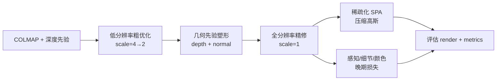

# TAGSs 实验总结文档

> 生成日期：2026-06-12  
> 清理日期：2026-08-31  
> 分析范围：早期 A100 全分辨率 bicycle 实验（v4–v14）的历史记录

**2026-08-31 清理说明：** 已删除效果差、已证伪或被后续版本替代的实验产物与脚本。当前主线见仓库根目录 `EXPERIMENT_SUMMARY.md` 文首表格（v16 / v15 E1b）。下文保留为早期 A100 调参叙事。

---

## 1. 项目概述

**TAGSs** 是在官方 [3D Gaussian Splatting (3DGS)](https://repo-sam.inria.fr/fungraph/3d-gaussian-splatting/) 代码库基础上扩展的**集成优化训练框架**。项目在原始 `train.py` 之外新增 `train_optimized.py` 与 `experiments/` 模块，将多种已有 3DGS 改进方法统一到一个可配置的训练引擎中。

当前实验以 **Mip-NeRF 360 数据集的 `bicycle` 场景** 为主要 benchmark：

| 项目 | 路径/说明 |
|------|-----------|
| 数据集 | `/root/highspeedstorage/TAGS-A100/data/bicycle`（来源：[Mip-NeRF 360](https://jonbarron.info/mipnerf360/)） |
| 单目深度先验 | `/root/highspeedstorage/TAGS-A100/data/bicycle/depth_any_out`（Depth Anything V2 生成） |
| 深度尺度标定 | `data/bicycle/sparse/0/depth_params.json` |
| 训练入口 | `train_optimized.py` |
| 实验输出 | `output/` |

评估协议：`--eval --llffhold 8`，30k 迭代，测试集指标由 `render.py` + `metrics.py` 计算（PSNR / SSIM / LPIPS）。

---

## 2. 要解决的问题

本实验围绕 **在保持/提升渲染质量的同时，让 3DGS 训练更稳定、更高效、更紧凑**，具体包括：

### 2.1 几何与外观质量

- **浮点伪影（floaters）与几何不稳定**：无纹理区域、深度歧义处易产生错误高斯。
- **单目深度噪声**：Depth Anything 等单目深度在边缘、高频纹理处不可靠，直接全图监督会伤害细节。
- **感知质量不足**：纯 L1 + SSIM 对高频细节、感知差异不敏感。
- **跨视角颜色/曝光不一致**：Mip-NeRF 360 户外场景存在曝光变化，影响 PSNR 与一致性。

### 2.2 训练效率与模型规模

- **高分辨率训练显存与时间开销大**：全分辨率从头训练代价高。
- **高斯数量膨胀**：densification 后点数过多，影响存储与渲染速度。
- **困难视角欠拟合**：均匀随机采样相机无法重点优化高误差视角。

### 2.3 实验验证目标

- 在 `bicycle` 上相对 **原始 3DGS baseline** 提升 PSNR / SSIM / LPIPS。
- 通过 **消融实验** 验证各模块（几何先验、分辨率调度、稀疏化、LPIPS、困难视角等）的独立贡献。
- 建立可复现的 **v4_restore 参考配置**，并在此基础上做 v5/v6/v7 迭代优化。

---

## 3. 实验思路

整体思路是 **「分阶段、多约束、晚精修」**：



**核心设计原则：**

1. **早期**：低分辨率 + 几何先验建立稳定结构，避免被噪声深度带偏。
2. **中期**：切换全分辨率，延长 densification，配合分组学习率与几何控制器抑制 oversized 高斯。
3. **晚期**：减弱几何先验权重，引入 LPIPS / 细节损失 / 颜色对齐；可选困难视角采样或损失重加权。
4. **稀疏化**：仅在全分辨率稳定后启动 GaussianSpa 式 ADMM 稀疏优化，最终 prune 压缩模型。

---

## 4. 核心算法与模块

### 4.1 基础渲染与 photometric 损失

- **渲染**：可微高斯光栅化（`gaussian_renderer` + `diff-gaussian-rasterization`）。
- **主损失**（`LossBuilder`）：

  \[
  \mathcal{L}_{photo} = (1-\lambda_{dssim})\|I - \hat I\|_1 + \lambda_{dssim}(1 - SSIM(I, \hat I))
  \]

  默认 `lambda_dssim=0.2`；若安装 `fused-ssim` 则加速 SSIM 计算。

- **Per-view 曝光补偿**：继承 Hierarchical 3DGS 思路，为每张图优化仿射曝光参数（`exposure_lr_init/final`）。

### 4.2 几何先验（DN-Splatter 风格，`GeometricPriorLoss`）

借鉴 [DN-Splatter](https://maturk.github.io/dn-splatter/) 的深度/法线监督思想（代码参考 `third_party/dn-splatter`），但实现为独立模块，适配 Inria 3DGS 渲染管线。

| 组件 | 算法要点 |
|------|----------|
| **深度损失** | 默认 `edge_aware_log_l1`：在 RGB 边缘处降低深度惩罚权重；可选 `log_l1` / `l1` / Charbonnier |
| **局部 Pearson 相关** | 128×128 patch 采样，缓解单目深度尺度漂移（`depth_prior_local_pearson_weight=0.05`） |
| **法线损失** | 由深度图估计法线，cosine 距离 + 可选 masked TV 平滑（`normal_prior_tv_weight`） |
| **可靠性掩码** | 综合 depth edge、RGB edge、局部方差分位数，仅在「平坦可靠区域」施加约束；保证最少 20% 像素参与 |
| **权重调度** | warmup → peak → decay（`geo_prior_warmup_until / decay_start / decay_until`）；全分辨率阶段自动 relax |
| **低纹理 relax** | v5 引入：低纹理区域减弱几何先验，避免过度平滑 |

相关原始 3DGS README 亦提及类似深度正则思路，参考 [DepthRegularizedGS](https://robot0321.github.io/DepthRegGS/index.html)、[SparseGS](https://formycat.github.io/SparseGS-Real-Time-360-Sparse-View-Synthesis-using-Gaussian-Splatting/)、[DNGaussian](https://fictionarry.github.io/DNGaussian/)、[Hierarchical 3DGS 深度正则](https://repo-sam.inria.fr/fungraph/hierarchical-3d-gaussians/)。

### 4.3 分辨率自适应调度（`ResolutionSchedule`）

- 配置格式：`"1200:4,4000:2,30000:1"` 表示迭代 ≤1200 用 1/4 分辨率，≤4000 用 1/2，之后全分辨率。
- **联动机制**：
  - SPA 稀疏化默认要求 `spa_require_full_resolution` 且 `spa_after_fullres_delay=3000`（全分辨率后延迟 3k iter 再启动）。
  - densification 截止时间自动延长到全分辨率就绪迭代（`effective_densify_until_iter`）。
  - 困难视角挖掘 / 颜色对齐默认要求 `fullres_ready`。

README 示例 schedule 为 `"2000:4,6000:2,30000:1"`；当前 bicycle 实验统一采用更激进的 `"1200:4,4000:2,30000:1"`。

### 4.4 稀疏优化（GaussianSpa 风格，`SparseController`）

借鉴 [GaussianSpa (CVPR 2025)](https://noodle-lab.github.io/gaussianspa) 的 **optimizing-sparsifying** 框架（代码参考 `third_party/GaussianSpa`）：

| 步骤 | 说明 |
|------|------|
| **ADMM 惩罚** | 对 opacity 引入辅助变量 \(z\) 与拉格朗日乘子 \(u\)，惩罚项 \(\frac{\rho}{2}\| \alpha - z + u \|^2\) |
| **Sparsifying** | 每 `spa_interval` 步更新 \(z\)，将低重要性 opacity 置零 |
| **Final prune** | `spa_end_iter` 时按 `prune_ratio2` 一次性剪枝 |
| **Hybrid 重要性** | `spa_metric=hybrid`：综合 opacity (20%)、渲染贡献 EMA (40%)、位置梯度 (30%)、2D 半径 (10%) |
| **结构保护** | `spa_protect_top_fraction=0.05` 保护高贡献/高梯度高斯不被剪掉 |

### 4.5 晚期精修损失（本项目扩展）

| 模块 | 作用 | 典型启动 iter |
|------|------|---------------|
| **Detail loss** | 高梯度区域上的图像梯度 L1，保留边缘细节 | 4000 |
| **LPIPS loss** | VGG 感知损失，改善 perceptual 质量 | 16000–20000 |
| **Color align loss** | 低梯度区域匹配 per-channel mean/std，稳定曝光/色调 | 18000–26000 |
| **Hard-view mining** | 按 per-view L1+SSIM EMA 加权采样困难相机 | 16000 (v5) |
| **Hard-view loss reweight** | 不改变采样，仅对困难视角略增损失权重（更保守） | 18000 (v4_restore) |

### 4.6 训练控制模块

| 模块 | 文件 | 功能 |
|------|------|------|
| **GroupLRScheduler** | `group_lr_scheduler.py` | 三阶段分别调节 geometry 参数 (xyz/scaling/rotation) 与 color 参数 (SH/opacity) 学习率倍率 |
| **GeometryController** | `geometry_controller.py` | 周期性 prune  oversized + 低 opacity 高斯，保护高梯度点 |
| **RegionEval** | `region_eval.py` | 按 `bicycle_region_boxes.json` 做主体/背景/车轮等区域 PSNR 评估 |
| **TrainingEngine** | `training_engine.py` | 统一调度采样、损失、densify、稀疏化、日志与 checkpoint |

### 4.7 边缘引导 densification

`edge_guided_densify_factor`（默认 0.90）在 detail loss 启动后缩放 densify 梯度阈值：factor < 1 时 **降低阈值、更积极 densify**（v5 消融中 0.72 为更强边缘 densify）。

---

## 5. 借鉴的已有方法与整合关系

| 方法 | 来源 | 在本项目中的用途 |
|------|------|------------------|
| **3D Gaussian Splatting** | Kerbl et al., SIGGRAPH 2023 | 基础框架、渲染器、densification |
| **DN-Splatter** | Turkulainen et al. | 深度/法线几何先验、局部 Pearson depth loss |
| **GaussianSpa** | Zhang et al., CVPR 2025 | ADMM 稀疏化 + 最终 prune |
| **Hierarchical 3DGS** | Inria | 深度 L1 权重调度、per-view 曝光补偿 |
| **Depth Anything V2** | Yang et al. | 单目深度先验生成（README 深度正则流程） |
| **Taming 3DGS** | Mallick & Goel, SIGGRAPH Asia 2024 | 可选加速 rasterizer + sparse Adam（`--optimizer_type sparse_adam`） |
| **Mip Splatting** | Yu et al. | 可选抗锯齿 `--antialiasing` |
| **SparseGS** | Patch-based depth correlation | DN-Splatter 文档中提及，本项目采用 local Pearson 作为替代 |
| **LPIPS** | Zhang et al. | 晚期感知损失 |

README 中的 integrated 命令示例概括了三支柱组合：

```bash
python train_optimized.py -s <COLMAP> \
  --enable_geo_prior --geo_prior_depth --geo_prior_normal \
  --depth_prior_local_pearson_weight 0.05 --normal_prior_tv_weight 0.003 \
  --enable_resolution_adaptive --resolution_schedule "2000:4,6000:2,30000:1" \
  --enable_sparse_optimization --sparse_mode spa \
  --spa_start_iter 10000 --spa_end_iter 22000 --rho_lr 0.0005 --prune_ratio2 0.08
```

当前 bicycle 最佳配置在此基础上有更细化的权重与阶段控制（见第 7 节）。

---

## 6. 代码架构

```
TAGSs/
├── train.py                  # 原始 3DGS 训练
├── train_optimized.py        # 集成实验入口
├── experiments/
│   ├── config.py             # ExperimentConfig 数据类
│   ├── training_engine.py    # 主训练循环
│   ├── loss_builder.py       # 复合损失
│   ├── geo_prior.py          # 几何先验
│   ├── sparse_controller.py  # GaussianSpa 稀疏化
│   ├── resolution_schedule.py
│   ├── group_lr_scheduler.py
│   ├── geometry_controller.py
│   ├── region_eval.py
│   └── evaluator.py
├── arguments/__init__.py     # ExperimentParams CLI 参数
├── scripts/                  # 各版本实验脚本
├── third_party/
│   ├── dn-splatter/          # 参考实现
│   └── GaussianSpa/          # 参考实现
└── output/                   # 实验结果
```

**配置持久化**：每次训练将完整 Namespace 写入 `output/<case>/cfg_args`，便于复现与对比。

---

## 7. 实验版本演进

### 7.1 版本时间线（由脚本与 output 推断）

| 版本 | 代表目录/脚本 | 主要变化 |
|------|---------------|----------|
| **origin** | `bicycle_origin`, 默认 `train.py` 风格 | 基线 3DGS + 深度图加载，无集成模块 |
| **v2 消融** | `run_bicycle_integrated_v2_ablation.sh` | 拆分 geo / resolution / spa / integrated 四组 |
| **v3** | integrated_v3, geo_masked | 引入 masked depth prior、保守 SPA (`prune_ratio2=0.08`) |
| **v4 / v4_repro** | `bicycle_integrated_v4_repro` | 加入 group LR、geometry controller、LPIPS；repro 为复现实验 |
| **v4_restore** | `run_bicycle_v4_restore.sh` | **当前最佳配置**；detail loss + hard-view loss reweight + color align |
| **v4_restore_baseline** | `run_bicycle_v4_restore_baseline.sh` | 去掉 hard-view / color align 的对照 |
| **v5** | `run_bicycle_v5.sh` | hard-view **采样** + 更强 color align + geo 低纹理 relax |
| **v6_conservative** | 等同 v4_restore | 保守回退，验证 v5 增益是否来自激进策略 |
| **v7 消融** | `run_bicycle_v7_v4restore_ablation.sh` | 以 v4_restore 为基准的单变量消融（LPIPS/detail/color/exposure/geo decay） |

### 7.2 当前最佳配置：`bicycle_integrated_v4_restore`

脚本 `scripts/run_bicycle_v4_restore.sh` 的关键超参：

| 类别 | 关键参数 |
|------|----------|
| 数据 | `resolution=-1`, `data_device=cpu`, `llffhold=8` |
| 几何先验 | depth final weight 0.04, normal 0.012, TV 0.0015, warmup 4k, decay 10k–20k |
| 分辨率 | `1200:4,4000:2,30000:1` |
| 细节 | detail loss final 0.03 @ iter 4000 |
| 困难视角 | `enable_hard_view_loss_reweight`, start 18000, max 1.12 |
| 颜色 | color align final 0.002 @ iter 24000 |
| 稀疏化 | SPA 13k–25k, prune_ratio2 0.04, hybrid metric |
| Densify | until 18000, grad threshold 0.00016 |

> **注意**：`output/bicycle_integrated_v4_restore/cfg_args` 中保存的部分 flags（如 `enable_group_lr_schedule=True`、detail loss=0）与 `run_bicycle_v4_restore.sh` 脚本存在差异，应以 **实际产出最佳 metrics 的那次运行 cfg_args** 为准。当前 results.json 对应 PSNR 25.495 的结果为权威指标。

### 7.3 v7 消融设计（进行中）

以 `bicycle_integrated_v4_restore` 为 baseline，每次只改一个变量：

| Case | 变量 |
|------|------|
| `bicycle_v7_lpips_weak_late` | LPIPS final 0.006, start 20000 |
| `bicycle_v7_lpips_strong_late` | LPIPS final 0.012, start 20000 |
| `bicycle_v7_detail_micro_late` | detail final 0.008, start 18000 |
| `bicycle_v7_color_ultralate` | 更晚、更弱的 color align |
| `bicycle_v7_exposure_mild` | exposure_lr_final 0.0012 |
| `bicycle_v7_geo_decay_long` | geo decay until 26000 |

---

## 8. 实验结果汇总

测试集全局指标（`results.json`, method=`ours_30000`）：

| 实验 | PSNR ↑ | SSIM ↑ | LPIPS ↓ | 相对 origin ΔPSNR |
|------|--------|--------|---------|-------------------|
| **bicycle_integrated_v4_restore** | **25.495** | **0.7740** | **0.1870** | **+0.344** |
| bicycle_v7_lpips_weak_late | 25.484 | 0.7735 | 0.1883 | +0.333 |
| bicycle_v7_lpips_strong_late | 25.484 | 0.7736 | 0.1867 | +0.333 |
| bicycle_v7_detail_micro_late | 25.478 | 0.7725 | 0.1904 | +0.327 |
| bicycle_v6_conservative | 25.448 | 0.7734 | 0.1873 | +0.297 |
| bicycle_v4_restore_optimized | 25.437 | 0.7733 | 0.1871 | +0.286 |
| bicycle_v5 | 25.412 | 0.7737 | 0.1872 | +0.261 |
| bicycle_integrated_v4_repro | 25.300 | 0.7693 | 0.1916 | +0.149 |
| bicycle_origin | 25.151 | 0.7620 | 0.2101 | — |

**结论摘要：**

- 集成模块相对 origin：**PSNR +0.34 dB，SSIM +0.012，LPIPS −0.023**（v4_restore）。
- v5 的 hard-view 采样 + 强 color align **未超过** v4_restore，v6 回退验证了这一判断。
- v7 早期完成的 LPIPS/detail 消融与 baseline 差距 < 0.02 dB，说明晚期微调已进入**收益递减区**；`v7_lpips_strong_late` 在 LPIPS 上略优（0.1867）但 PSNR 仍略低于 baseline。
- `bicycle_integrated_v4_repro` 明显差于 v4_restore，说明 **超参细节与训练策略** 对结果影响显著，复现需严格对齐 cfg_args。

---

## 9. 完整实验流程

### 9.1 数据准备

1. 获取 Mip-NeRF 360 `bicycle` COLMAP 数据 → `data/bicycle/`
2. 使用 [Depth Anything V2](https://github.com/DepthAnything/Depth-Anything-V2) 生成深度图 → `depth_any_out/`
3. 运行 `python utils/make_depth_scale.py` 生成 `depth_params.json`

### 9.2 训练

```bash
cd /root/highspeedstorage/TAGS-A100/TAGSs

# 最佳配置（v4_restore）
bash scripts/run_bicycle_v4_restore.sh

# 或 v7 消融批量实验
bash scripts/run_bicycle_v7_v4restore_ablation.sh
```

环境变量可覆盖路径：

```bash
SOURCE=/path/to/bicycle DEPTHS=/path/to/depths MODEL=/path/to/output bash scripts/run_bicycle_v4_restore.sh
```

`TAGGS_CPU_KNN_INIT=1` 用于避免 GPU KNN 初始化 OOM。

### 9.3 渲染与评估

```bash
python render.py -m output/bicycle_integrated_v4_restore --skip_train --quiet
python metrics.py -m output/bicycle_integrated_v4_restore --split test
```

### 9.4 区域评估（可选）

```bash
python scripts/evaluate_local_crops.py \
  -m output/bicycle_integrated_v4_restore \
  --split test --method ours_30000 \
  --boxes_json scripts/bicycle_region_boxes.json \
  --output output/bicycle_integrated_v4_restore/region_metrics_test.json
```

区域框包括：`subject`、`background`、`wheel_front`、`wheel_rear`、`frame_mid`、`bg_highfreq`。

### 9.5 结果汇总

```bash
# v7 消融汇总（训练完成后自动生成）
python scripts/summarize_v4restore_ablation.py \
  --output_root output \
  --baseline_case bicycle_integrated_v4_restore \
  --cases bicycle_v7_lpips_weak_late bicycle_v7_lpips_strong_late ... \
  --method ours_30000 \
  --out_md output/bicycle_v7_v4restore_ablation_summary.md
```

---

## 10. 训练阶段时间轴（v4_restore 典型配置）

| 迭代区间 | 分辨率 | 主要活动 |
|----------|--------|----------|
| 0 – 1200 | 1/4 | 粗结构、geo prior warmup 开始 |
| 1200 – 4000 | 1/2 | 几何塑形、detail loss 启动 (4k) |
| 4000 – 13000 | 1/2 → 1/1 | 全分辨率 @4000；densify 持续至 18k |
| 13000 – 25000 | 全分辨率 | SPA 稀疏化（13k 起，全分辨率 +3k delay 后生效） |
| 16000 – 30000 | 全分辨率 | LPIPS / hard-view reweight / color align 晚期精修 |
| 25000 | — | SPA final prune |
| 30000 | — | 保存最终模型 + 测试评估 |

---

## 11. 关键脚本索引

| 脚本 | 用途 |
|------|------|
| `scripts/run_bicycle_v4_restore.sh` | **主推配置**，当前最佳结果 |
| `scripts/run_bicycle_v4_restore_baseline.sh` | 去掉晚期 reweight/color 的对照 |
| `scripts/run_bicycle_v5.sh` | hard-view 采样实验 |
| `scripts/run_bicycle_v6_conservative.sh` | 回退至 v4_restore |
| `scripts/run_bicycle_v7_v4restore_ablation.sh` | v7 单变量消融 + 自动汇总 |
| `scripts/run_bicycle_v5_ablation.sh` | v5 组件消融（exposure/densify/lpips） |
| `scripts/run_bicycle_integrated_v2_ablation.sh` | 早期 geo/resolution/spa 拆分消融 |
| `scripts/analyze_bicycle_experiments.py` | 渲染图梯度/频域对比分析 |
| `scripts/summarize_ablation_results.py` | 通用消融 metrics 汇总 |

---

## 12. 后续建议

1. **以 `bicycle_integrated_v4_restore` 为 frozen baseline**，继续完成 v7 剩余 case（color_ultralate、exposure_mild、geo_decay_long）。
2. **优先看 LPIPS 与区域 metrics**，全局 PSNR 已进入平台期；`v7_lpips_strong_late` 值得在更多视角/区域上细查。
3. **固定 cfg_args 与随机种子**，避免 repro 版本与 restore 版本配置漂移。
4. 若拓展到其他 Mip-NeRF 360 场景，需 **逐场景调整** geo prior 权重与 SPA prune 比例（README 亦指出深度正则因场景而异）。
5. 可选启用 `--optimizer_type sparse_adam` + Taming-3DGS 加速分支，在质量对齐前提下缩短迭代 wall-clock 时间。

---

## 13. 参考文献

```bibtex
@Article{kerbl3Dgaussians,
  author  = {Kerbl, Bernhard and Kopanas, Georgios and Leimk{\"u}hler, Thomas and Drettakis, George},
  title   = {3D Gaussian Splatting for Real-Time Radiance Field Rendering},
  journal = {ACM Transactions on Graphics},
  year    = {2023}
}

@inproceedings{zhang2025gaussianspa,
  title  = {GaussianSpa: An Optimizing-Sparsifying Simplification Framework for Compact and High-Quality 3D Gaussian Splatting},
  author = {Zhang, Yangming and Jia, Wenqi and Niu, Wei and Yin, Miao},
  booktitle = {CVPR},
  year   = {2025}
}

@inproceedings{turkulainen2024dnsplatter,
  title  = {DN-Splatter: Depth and Normal Priors for Gaussian Splatting},
  author = {Turkulainen, Matias and others},
  year   = {2024}
}
```

---

## 14. 详细效果与问题分析（截至 v9 进行中）

> 更新日期：2026-06-14  
> 数据来源：`output/` 下 v4_restore baseline、v7/v8 消融汇总、v9 首批结果

### 14.1 实验进展的两段式结构

当前优化过程可明确分为两个阶段，收益性质完全不同：

| 阶段 | 范围 | 代表配置 | PSNR 提升 | 性质 |
|------|------|----------|-----------|------|
| **结构优化** | origin → v4_restore | 几何先验 + 分辨率调度 + SPA + group LR + geometry controller | ≈ **+0.34 dB**（相对 origin 25.15） | 实质性、可解释、模块间协同 |
| **晚期微调** | v7 → v8 → v9 | color align、geo decay 尾部延长 | ≈ **+0.018 dB**（v8 soft 相对 v4_restore） | 边际收益、视角间 trade-off、接近噪声地板 |

**结论**：集成管线（v4_restore）已吃掉大部分可榨取的全局收益；v7 以后的手动调参是在 **0.02 dB 量级** 上竞争，必须改用 per-view / 区域指标验收，否则无法区分真实改进与随机波动。

### 14.2 实际 baseline 与脚本配置不一致（重要）

`output/bicycle_integrated_v4_restore/cfg_args` 显示，**当前作为消融基线的模型** 实际启用了：

- `enable_group_lr_schedule=True`
- `enable_geometry_controller=True`
- `lpips_loss_weight_final=0.01`（16k 起）
- `geo_prior_decay_until=24000`
- **未启用** `color_align`（相关参数为默认值 0）
- **未启用** `detail_loss`（final=0）
- **未启用** `hard_view_loss_reweight`

而 `scripts/run_bicycle_v4_restore.sh` 描述的是另一套配置（含 detail loss、hard-view reweight、color align）。  
**v7/v8 的「相对 baseline 提升」主要来自在现有强基线上叠加 color align + 延长 geo 尾部**，而非脚本名所暗示的那套 v4_restore 配方。

### 14.3 全局指标：当前排名与解读

| Case | PSNR | SSIM | LPIPS | ΔPSNR vs baseline |
|------|------|------|-------|-------------------|
| **bicycle_v8_color_geo_soft** | **25.513** | **0.7746** | **0.1863** | **+0.018** |
| bicycle_v7_color_ultralate | 25.504 | 0.7744 | 0.1866 | +0.010 |
| bicycle_v9_geo245_color_ultralate | 25.502 | 0.7740 | 0.1864 | +0.008 |
| bicycle_v7_geo_decay_long | 25.499 | 0.7743 | 0.1867 | +0.005 |
| **bicycle_integrated_v4_restore** | 25.495 | 0.7740 | 0.1870 | — |
| bicycle_v8_color_geo_ultralate | 25.476 | 0.7735 | 0.1871 | **−0.019** |

Top 配置 PSNR 极差仅 **0.018 dB**（4 个候选之间），已处于 **单次训练随机波动的同一量级**。

### 14.4 视角级分析：全局平均掩盖 trade-off

#### （1）v8 soft 的收益高度集中

相对 baseline，`bicycle_v8_color_geo_soft` 的 PSNR 正向增益中：

- **00004.png** 贡献 +0.293 dB
- **00001.png** 贡献 +0.227 dB
- **00020.png** 贡献 +0.103 dB  
- 上述 3 个视角占全部正向增益的 **56.8%**

同时存在明显回退：

| 视角 | ΔPSNR | ΔLPIPS | 特征 |
|------|-------|--------|------|
| 00008.png | **−0.229** | ≈0 | baseline PSNR=25.08，中等难度视角 |
| 00011.png | −0.126 | **+0.0034** | 感知回退最明显之一 |
| 00016.png | −0.054 | +0.0017 | 与 color std 项相关疑点多 |
| 00021.png | −0.036 | +0.0022 |  chronic 回退视角 |

**per-view 统计（v8 soft）**：PSNR 15 升 / 10 降；SSIM 18 升 / 7 降；LPIPS 17 升 / 8 降。  
→ **全局三项略优，但约 40% 测试视角 PSNR 变差**；这是「临时 best case」不能固化为最终配置的核心原因。

#### （2）慢性问题视角（v7/v8 7 个 case 统计）

以下视角在 **全部 7 个** 晚期调参 case 中 PSNR 均低于 baseline：

- `00008.png`、`00011.png`、`00016.png`、`00017.png`、`00018.png`

说明这些视角的退化 **不是某次偶然配置**，而是「晚期 color/geo 正则 + 当前 SPA 剪枝结果」下的系统性弱点。  
其中 00017/00018 baseline PSNR 已经很高（27–29 dB），晚期扰动更容易表现为「过拟合调整导致回退」。

#### （3）v9 首批结果揭示的新 trade-off

已完成 case `bicycle_v9_geo245_color_ultralate`（`geo_decay_until=24500`，color 同 v8 soft）：

| 指标 | vs baseline | vs v8 soft |
|------|-------------|------------|
| 全局 PSNR | +0.008 dB | **−0.011 dB** |
| 全局 SSIM | ≈0 | 略低 |
| 全局 LPIPS | −0.0006 | 略优 |

但在 **慢性问题视角** 上 v9 明显优于 v8 soft：

| 视角 | v8 soft ΔPSNR | v9 geo245 ΔPSNR |
|------|---------------|-----------------|
| 00008.png | −0.229 | **−0.063** |
| 00011.png | −0.126 | **−0.016** |
| 00016.png | −0.054 | −0.047 |
| 00021.png | −0.036 | −0.024 |

→ **缩短 geo 尾部（25000→24500）能显著缓解局部回退，但会牺牲 00001/00004 上的大幅增益**。  
这提示：不存在「全局三项都更好且无视角回退」的单点配置，需要在 **全局均值 vs 最差视角 vs LPIPS** 之间做多目标取舍。

### 14.5 模块级消融：已验证的有效/无效方向

#### 有效或弱有效

| 模块 | 证据 | 机制推断 |
|------|------|----------|
| **color align（超晚期、弱权重）** | v7 color_ultralate +0.010 dB；v8 soft 组合最优 | 低梯度区域 mean/std 对齐，补偿 exposure 残余误差 |
| **geo decay 轻度延长（24k→25k）** | v8 soft 优于单独 color；v7 geo_decay_long 单独 +0.005 dB | 略延长几何约束，帮助晚期结构稳定 |
| **两者组合** | v8 soft > 任一单变量 | 存在协同，但重叠区间（26k–30k）过长会过约束 |

#### 明确无效或有害

| 模块 | 证据 | 原因 |
|------|------|------|
| **geo_decay_until=26000** | v8 ultralate 全局三项全退；SSIM 7 升/18 降 | 几何尾部过长 → 晚期过平滑 |
| **仅削弱 color（v8 color_lean）** | SSIM/LPIPS 低于 baseline | 收益依赖 color+geo 组合，不能单拆 |
| **LPIPS 训练损失（v7）** | weak/strong 全局 PSNR 均 −0.01 dB 量级 | 与 photometric 目标冲突，24/25 视角 LPIPS 恶化（weak） |
| **detail micro loss（v7）** | LPIPS **25/25 视角全部回退** | 边缘梯度 loss 过强，破坏已有颜色/结构平衡 |
| **hard-view 采样（v5）** | 未超过 v4_restore | 采样扰动过大，不稳定 |
| **exposure_lr 微调（v7 mild）** | 全局略负 | baseline 曝光已较充分 |

### 14.6 当前存在的结构性问题

1. **收益/风险比过低**  
   v8 soft 全局 +0.018 dB 的代价是 10 个视角 PSNR 回退、8 个视角 LPIPS 回退；工程上性价比不足。

2. **缺乏统计显著性验证**  
   无多种子重复；0.01–0.02 dB 差异可能是初始化 / 相机采样随机性，不能作为「新 best」的充分证据。

3. **配置与脚本漂移**  
   `run_bicycle_v4_restore.sh` ≠ 实际 baseline `cfg_args`；后续对比若混用会造成结论混乱。

4. **评估维度不足**  
   `output/` 中 **无 region_metrics**（`evaluate_local_crops.py` 未跑）；无法验证 subject/wheel/background 是否一致改进。

5. **晚期正则时间重叠**  
   v8 soft 在 26k–30k 同时有：geo 尾部（decay 至 25k 后仍有余量）、color align、LPIPS、group LR stage3（color LR ×0.8）。多目标在最后一阶段竞争，是视角 trade-off 的重要来源。

6. **`color_align_std_weight` 风险**  
   color align 同时约束 channel mean 与 std；00011/00016/00021 的 LPIPS 回退与 std 项高度相关。v9 `color_mean_only` case 尚未完成，需优先等待该结果。

7. **实验状态追踪 bug（已部分修复）**  
   v8 使用 `.v8_v4restore_refine_case_done`，旧汇总脚本读 `.v4restore_ablation_case_done` 导致 done marker 显示 `no`；不影响 metrics，但影响自动化流水线。

8. **v9 进度不完整**  
   5 个 v9 case 中仅 `geo245_color_ultralate` 完成；主候选 `geo245_color_later_weak` 仍在训练队列中。

### 14.7 问题视角的可能成因（待可视化确认）

| 视角 | baseline PSNR | 现象 | 推测 |
|------|---------------|------|------|
| 00008.png | 25.08 | 所有晚期调参均回退；v8 最严重 | 特定几何/遮挡；color align 改变低频色调；SPA 剪枝损伤贡献高斯 |
| 00011.png | 24.09 | LPIPS 回退 chronic | 低梯度区域大，color std 改变局部对比度 |
| 00001/00004 | 19.30/22.17 | color align 大幅受益 | 低 PSNR 视角曝光/颜色偏差大，mean/std 对齐直接受益 |
| 00017/00018 | 27.34/29.33 | 高 PSNR 视角易回退 | 已接近饱和，任何晚期扰动都表现为负向 delta |

**建议**：对 00008/00011 做 render vs GT 差分图、梯度热力图、color align mask 可视化，区分是 **几何错误** 还是 **颜色/对比度漂移**。

### 14.8 优化方向判断（结合 v9 plan）

| 方向 | 判断 | 依据 |
|------|------|------|
| A. geo tail 24500–25000 边界搜索 | **值得继续** | v9 geo245 已改善 chronic views |
| B. color 更晚更弱（27500, std=0.15） | **主方向** | 减少 26k–30k 重叠扰动 |
| C. color mean-only 消融 | **必须做** | 隔离 std 项风险 |
| D. hard-view reweight max=1.05 | **仅验证** | v5 已证明采样版无效 |
| E. 继续加 LPIPS/detail/geo 权重 | **应停止** | v7 已充分证伪 |
| F. 全局 PSNR 单目标手动调参 | **应停止** | 进入平台期；转 per-view Pareto |

**推荐验收标准**（比「全局 +0.01 dB」更合理）：

1. 全局 PSNR ≥ baseline 且 LPIPS ≤ baseline  
2. chronic 四视角（00008/11/16/21）最大 PSNR 回退 **小于 v8 soft**  
3. PSNR 回退视角数 ≤ 8/25（优于 v8 的 10/25）  
4. 至少 1 次不同 seed 复现  

### 14.9 当前推荐状态

| 角色 | 配置 | 说明 |
|------|------|------|
| **生产 baseline** | `bicycle_integrated_v4_restore` | 稳定、无 color align 依赖、全局 25.495 dB |
| **研究 best（临时）** | `bicycle_v8_color_geo_soft` | 全局最高但 40% 视角 PSNR 回退 |
| **per-view 更均衡候选** | `bicycle_v9_geo245_color_ultralate` | 全局略低于 soft，chronic views 明显更好 |
| **待验证主候选** | `bicycle_v9_geo245_color_later_weak` | v9 设计中最可能同时满足全局与 per-view 约束 |

---

## 15. v10 实验架构更新（balanced-fast）

> 更新日期：2026-06-16  
> 目标：避免 v8/v9 中的明显视角回退，同时删除已知负收益或高开销环节以提高训练迭代速度。

### 15.1 当前可用 v9 结果补充

`output/` 中新增 `bicycle_v9_geo250_color_later_weak`，但其 `results.json` 显示 `PSNR=9.31 / SSIM=0.00498 / LPIPS=0.722`，per-view 指标也整体异常，判断为失败或无效产物，**不纳入架构选择依据**。

当前仍可采信的 v9 结果是 `bicycle_v9_geo245_color_ultralate`：

- 相对 baseline：PSNR +0.008 dB，LPIPS -0.0006，SSIM 基本持平。
- 相对 v8 soft：全局 PSNR 下降，但 00008/00011/00016/00021 等慢性问题视角的回退明显缓解。

### 15.2 保留与删除

**保留为结构骨架**：

- 几何先验 depth + normal，保持 `geo_prior_decay_start=12000`。
- 分辨率调度 `1200:4,4000:2,30000:1`。
- Group LR schedule、GeometryController、GaussianSpa SPA。
- per-view 汇总作为验收标准，不再只按全局 PSNR 排名。

**默认删除或不再作为主方向**：

- LPIPS 训练损失：v7 weak/strong 未带来可靠 PSNR 收益，且引入额外 VGG forward 开销；默认权重改为 0。
- Detail loss：v7 `detail_micro_late` 导致 LPIPS 25/25 视角全部回退。
- Hard-view 采样/重加权：v5 采样不稳定，v9 guarded reweight 仅保留历史验证价值，不进主线。
- exposure_lr 微调：v7 mild 全局略负。
- `geo_decay_until=26000` 与高 `color_align_std_weight`：已和 late over-smoothing / LPIPS 回退相关。

### 15.3 新脚本

新增脚本：`scripts/run_bicycle_v10_balanced_fast.sh`

默认只跑两个 case：

| Case | 设计 |
|------|------|
| `bicycle_v10_no_late_regularizers` | 稳定加速基线：保留结构模块，关闭 LPIPS/detail/color/hard-view |
| `bicycle_v10_geo245_color_mean_late` | 主候选：`geo_decay_until=24500` + 28k 起超晚期 mean-only color align，`std_weight=0` |

推荐运行：

```bash
cd /root/highspeedstorage/TAGS-A100/TAGSs
bash scripts/run_bicycle_v10_balanced_fast.sh
```

快速只跑主候选：

```bash
ONLY_CASE=bicycle_v10_geo245_color_mean_late bash scripts/run_bicycle_v10_balanced_fast.sh
```

验收标准沿用 14.8，但优先关注：

1. 全局 PSNR 不低于 baseline 或回退 < 0.01 dB。
2. PSNR 回退视角数少于 v8 soft 的 10/25。
3. 00008/00011/00016/00021 的最大回退明显小于 v8 soft。
4. LPIPS 不高于 baseline。

---

*本节随 v9/v10 剩余 case 完成后应更新 14.3、14.9、15.1 及排名表。*

---

*本文档由代码与实验产物自动分析生成，如有脚本更新请同步修订第 7–8、14 节。*
